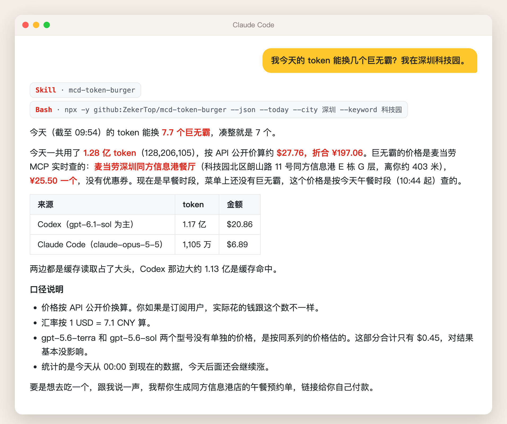
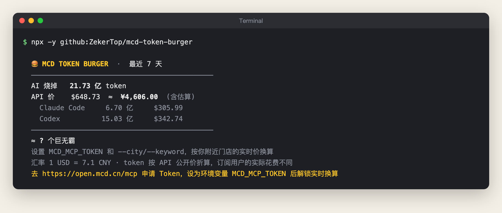
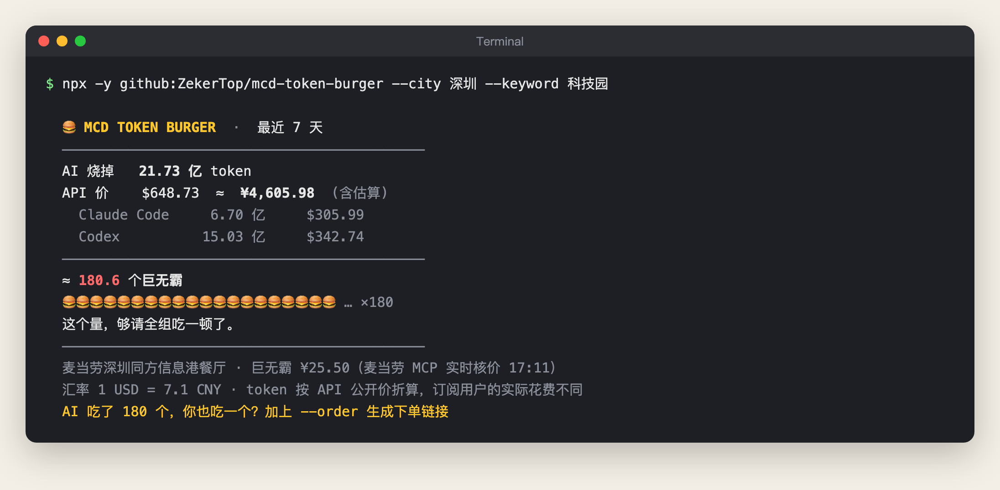
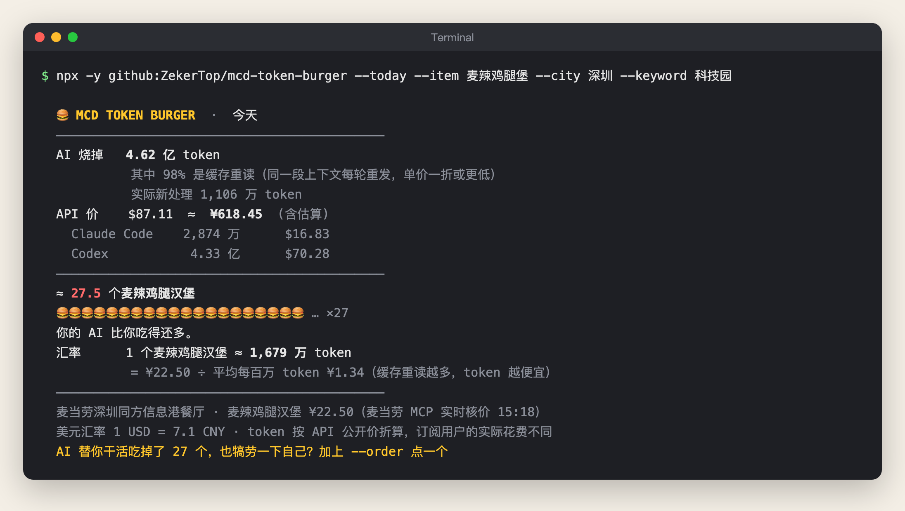
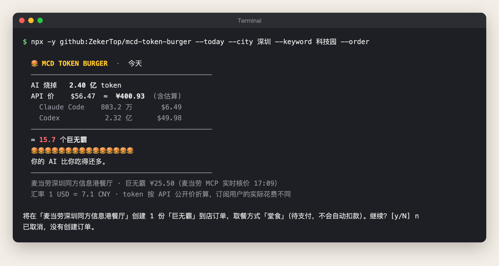
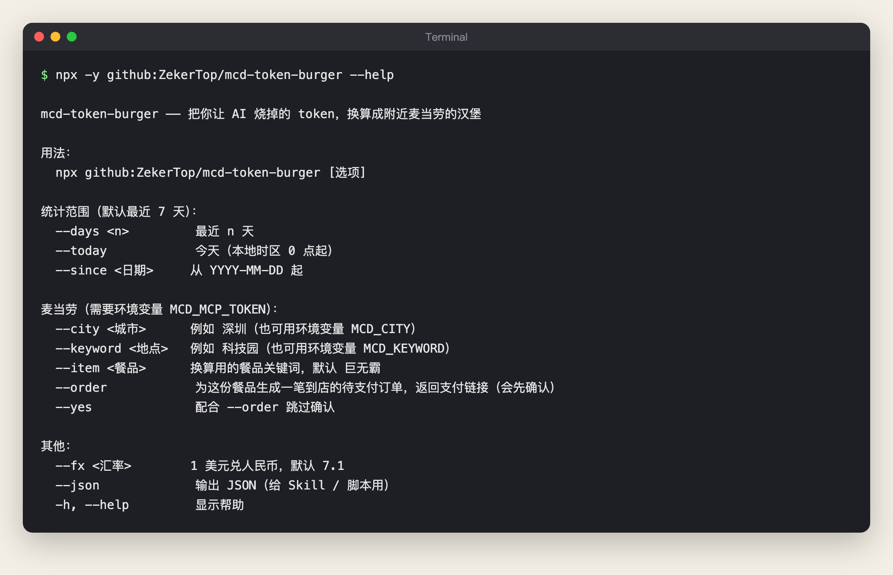

# 🍔 mcd-token-burger

[中文](README.md) | **English**

**How many Big Macs are your AI tokens worth? Your AI has eaten that many. Treat yourself to one.**

Ask your AI, "How many Big Macs are my tokens worth this week?" It totals the tokens you have used in Claude Code and Codex, converts them to RMB at public API prices, and checks the **live price** at a McDonald's near you through the [McDonald's China MCP](https://open.mcd.cn/mcp) to tell you how many burgers that money buys. Your AI did a day's work, and so did you. Say "treat myself, order one for me" and it creates an in-store order, dine-in or takeaway, for you to pay yourself.

**You do everything by chatting. No commands to type.**



> The screenshot is a real exchange in a fresh Claude Code session on 2026-10-16. It has been re-laid out for display, and the only edit is removing the salutation the author's personal settings add. The user typed one sentence. The AI loaded the Skill, counted the tokens, found the store and checked the price on its own. The tool's output is in Chinese.
>
> This is an entry in the McDonald's China Programmer's Day Creative Development Challenge. It is an independent personal project, not an official McDonald's product.

## Contents

- [Who it's for](#who-its-for)
- [What it does](#what-it-does)
- [Get started in 3 steps](#get-started-in-3-steps)
- [Install guide for AI agents](#install-guide-for-ai-agents)
- [Prefer the command line?](#prefer-the-command-line)
- [How it calculates](#how-it-calculates)
- [McDonald's MCP tools used](#mcdonalds-mcp-tools-used)
- [Privacy and safety](#privacy-and-safety)
- [FAQ](#faq)
- [Known limitations](#known-limitations)
- [Development](#development)

## Who it's for

- **Developers who've coded all day and want to treat themselves.** See how much your AI "ate" this week, then have it order one for you too.
- **Claude Max or ChatGPT Pro subscribers** curious about how much their plan saves them compared with API prices.
- **Anyone who wants a fun line for a team update or social post.** "My AI ate 180 Big Macs this week" lands better than "I used 2.1 billion tokens".

## What it does

| You say | The AI |
|---|---|
| "How many Big Macs are my tokens worth this week? I'm near Shenzhen Science Park." | Totals the last 7 days of local Claude Code and Codex tokens, converts them to RMB at API prices, finds the nearest store and uses the live Big Mac price to count burgers |
| "What about today?" "This month?" | Recalculates for that period |
| "Use the McSpicy instead" | Uses your chosen item as the unit. It still matches when the menu name is slightly different, and it prefers the single item over a meal |
| Asking at 8 a.m. | Big Macs aren't sold at breakfast, so it uses the store's lunch price for today and tells you so |
| "Treat myself, order one for me, takeaway" | Tells you the store, item and price, asks whether you want dine-in or takeaway, waits for your OK, then creates one unpaid order, gives you the payment link and reminds you to pay within 15 minutes. Nothing is charged automatically |

## Get started in 3 steps

### Step 1: Get a McDonald's MCP token (free, about a minute)

Open [open.mcd.cn/mcp](https://open.mcd.cn/mcp), click 登录 (Log in) in the top-right corner and verify with your phone number. Once you're logged in, the button changes to 控制台 (Console):


Click 控制台 (Console), then 激活 (Activate), and accept the service agreement:


Once it's activated, copy the token with one click:


> These three images come from the [official McDonald's challenge guide](https://github.com/M-China/mcd-developer-innovation-challenge). The token is a key to your McDonald's account. Don't share it, and don't commit it to a repository.

### Step 2: Let your AI set it up

**With Claude Code, Codex or another AI that can run commands**: send it the message below, with your own token at the end:

```text
Please install mcd-token-burger: https://github.com/ZekerTop/mcd-token-burger
Follow the "Install guide for AI agents" section of its README, then run the check.
My McDonald's MCP token is: paste your token here
```

The AI installs the Skill, saves the token and runs a check. The exact steps are in the [Install guide for AI agents](#install-guide-for-ai-agents) below. Once it's done, **start a new conversation** so the Skill loads.

**With WorkBuddy**: a few clicks in the app, no commands either (steps from the [official McDonald's challenge guide](https://github.com/M-China/mcd-developer-innovation-challenge#workbuddy-开发指南)).

1. In the left sidebar, open 专家·技能·连接器 (Experts · Skills · Connectors), choose the 连接器 (Connectors) tab, then click 自定义连接器 (Custom connector) → 配置MCP (Configure MCP) in the top-right corner.
2. Paste the configuration below, replace `YOUR_MCP_TOKEN` with your token and click 保存 (Save). Go back to 自定义连接器 (Custom connector) and enable mcd-mcp.
3. In the 技能 (Skills) tab of the same sidebar, add the [`skills/mcd-token-burger`](skills/mcd-token-burger) folder from this repository. See the [WorkBuddy docs](https://www.workbuddy.cn/docs/workbuddy/From-Beginner-to-Expert-Guide/Function-Description/Connector) for how to import a Skill.

```json
{
  "mcpServers": {
    "mcd-mcp": {
      "type": "streamablehttp",
      "url": "https://mcp.mcd.cn",
      "headers": {
        "Authorization": "Bearer YOUR_MCP_TOKEN"
      }
    }
  }
}
```

Cursor, TRAE, Cherry Studio and other clients connect to the McDonald's MCP with the same configuration. See the [official McDonald's MCP guide](https://github.com/M-China/mcd-mcp-server) for where to put it.

### Step 3: Just ask

Tell your AI:

> How many Big Macs are my tokens worth this week? I'm near Shenzhen Science Park.

Use your own city and area. The AI counts the tokens, finds the store and checks the price. The result looks like the screenshot at the top of this page.

Your AI did all that work. Treat yourself too:

> Treat myself, order one for me, takeaway.

The AI tells you the store, item, price and pickup method (dine-in or takeaway) first, and creates the order **only after you agree**. Then it gives you the payment link. The order stays unpaid until you pay, and **must be paid within 15 minutes** or it expires. Nothing is charged if you don't pay.

## Install guide for AI agents

> This section is for AI agents. When a user asks you to install mcd-token-burger, follow these steps.

1. **Install the Skill**: copy the repository's `skills/mcd-token-burger` folder into your skills directory. For Claude Code, that is `~/.claude/skills/`:

   ```bash
   git clone --depth 1 https://github.com/ZekerTop/mcd-token-burger.git /tmp/mcd-token-burger
   mkdir -p ~/.claude/skills && cp -r /tmp/mcd-token-burger/skills/mcd-token-burger ~/.claude/skills/
   ```

   Other agents use their own skills directory. If it's already installed, overwrite it with the new version.

2. **Save the McDonald's MCP token**: write the user's token to `~/.mcd_mcp_token`, set its permissions to 600, and have the shell load it on startup. **Don't echo the token in your output, and never write it into a code repository.**

   ```bash
   printf '%s' '<user token>' > ~/.mcd_mcp_token && chmod 600 ~/.mcd_mcp_token
   grep -q mcd_mcp_token ~/.zshrc 2>/dev/null || printf '%s\n' '[ -f ~/.mcd_mcp_token ] && export MCD_MCP_TOKEN="$(tr -d '"'"'\r\n'"'"' < ~/.mcd_mcp_token)"' >> ~/.zshrc
   ```

   If the user's shell is bash, use `~/.bashrc` instead of `~/.zshrc`. If the user gave no token, skip this step, install only the Skill, and tell the user that without a token they'll only see the token count and amount.

   If your client supports configuring MCP servers, you can also connect mcd-mcp with the JSON from Step 2 above.

3. **Check it works**: in a new shell, run this and confirm that `usage.tokens` in the JSON output is a number:

   ```bash
   npx -y github:ZekerTop/mcd-token-burger --today --json
   ```

   If a token was set, run it again with `--city <city> --keyword <area>` and confirm `burger.count` has a value. If `burgerError` or `hint` mentions 401, the token is invalid; ask the user to copy it again.

4. **Tell the user**: it's installed. **In a new conversation**, they can ask "How many Big Macs are my tokens worth this week? I'm near …".

## Prefer the command line?

Behind the scenes, the AI calls a zero-dependency command-line tool from this repository, and you can run it yourself. You need [Node.js](https://nodejs.org/) 18 or later. You don't need to clone anything or install dependencies.

<details>
<summary><b>Show command-line usage and screenshots</b></summary>

### Tokens and cost only (no McDonald's token needed)

```bash
npx -y github:ZekerTop/mcd-token-burger
```



### Convert to burgers at a nearby store

City and area names are in Chinese, for example `--city 北京 --keyword 中关村`.

```bash
export MCD_MCP_TOKEN=your_token
npx -y github:ZekerTop/mcd-token-burger --city 深圳 --keyword 科技园
```



### Use a different item; breakfast falls back to the lunch price

```bash
npx -y github:ZekerTop/mcd-token-burger --today --item 麦辣鸡腿堡 --city 深圳 --keyword 科技园
```



### Order

With `--order`, the tool shows the store, item and pickup method, then waits for you to type `y`. Once you confirm, it creates one unpaid order and returns a payment link and payment deadline (15 minutes after ordering, in testing). Nothing is charged automatically. In this screenshot the answer was `n`, so no order was created.

The pickup method defaults to the first one the store returns (currently dine-in). For takeaway, add `--pickup 外带`:

```bash
npx -y github:ZekerTop/mcd-token-burger --city 深圳 --keyword 科技园 --order
npx -y github:ZekerTop/mcd-token-burger --city 深圳 --keyword 科技园 --order --pickup 外带
```



### All options



| To | Add |
|---|---|
| See only today | `--today` |
| See the last 30 days | `--days 30` |
| Count from a given date | `--since 2026-10-01` |
| Use a different item as the unit | `--item 麦辣鸡腿堡` |
| Treat yourself with an order link | `--order` (asks first; add `--yes` to skip the prompt) |
| Takeaway | `--pickup 外带` (default is dine-in, 堂食) |
| Change the USD exchange rate | `--fx 7.2` (default 7.1) |
| Get JSON | `--json` |

You can also set the city and area with the `MCD_CITY` and `MCD_KEYWORD` environment variables. On Windows PowerShell, set the token with `$env:MCD_MCP_TOKEN="your_token"`. Every terminal screenshot on this page is real output from running this repository with `npx`.

</details>

## How it calculates

```text
Local logs ──read──▶ tokens per model ──× public API price──▶ USD ──× FX rate──▶ RMB
                                                                                 │
McDonald's MCP: query-nearby-stores → query-meals → calculate-price ──▶ unit price (fen)
                                                                                 ▼
                                                              RMB ÷ unit price = burgers
```

**The exchange rate: how many tokens make one Big Mac?** The card shows a line like "1 个巨无霸 ≈ N 万 token" (1 Big Mac ≈ N × 10,000 tokens). That's the "Token-to-Burger exchange rate" in the project name. It's calculated, not fixed:

```text
rate = Big Mac price ÷ average API price per token
```

From the author's machine over the last 7 days: 2.414 billion tokens cost about ¥4,675.68 at API prices, an average of ¥1.94 per million tokens. A Big Mac costs ¥25.50, so 1 Big Mac ≈ 13.17 million tokens.

Why do the totals so often reach hundreds of millions? On every step, an agent sends the whole conversation and every file it has read back to the model, so the same context gets counted dozens of times. These are cache reads. On the author's machine, 96% of tokens were cache reads, and only 99.29 million tokens were newly processed. Cache reads cost a tenth of the normal input price or less, so hundreds of millions of tokens don't cost hundreds of millions of tokens' worth of money. The card lists this share separately.

The rate depends on two things: the store's price and how you use AI. The higher your cache share and the cheaper your models, the cheaper each token is, and the more tokens one Big Mac is worth.

- **Claude Code**: reads `usage` from each response in `~/.claude/projects/**/*.jsonl`. One response can appear on several log lines, so entries are deduplicated by `message.id + requestId`.
- **Codex**: reads `token_count` events from `~/.codex/sessions` and `archived_sessions`, and works out each turn's usage from the difference between running session totals. Resumed or forked session files start with the earlier totals, so those entries use only `last_token_usage` to avoid double counting.
- **Prices**: input, output, cache writes and cache reads are priced separately. Claude prices come from Anthropic's official price list. GPT prices come from a third-party price tracker and **haven't been checked against OpenAI's official pricing**. Models missing from the table are estimated at the latest model in the same family and marked as estimates. The price table is in [`src/pricing.js`](src/pricing.js).
- **Burger price**: comes from the official `calculate-price` check in the McDonald's MCP. It's in fen (0.01 RMB) and already includes the store's automatic discounts, so it isn't the printed menu price.

If you're on a Claude Max or ChatGPT Pro plan, what you actually pay is the subscription fee. The amount shown is what your usage would cost at API prices, not your real bill.

## McDonald's MCP tools used

| Tool | When it's called | What it's for |
|---|---|---|
| `query-nearby-stores` | Every conversion | Finds the nearest store by city and area, along with the store's bookable time slots |
| `query-meals` | Every conversion | Finds the item on the store's menu; at breakfast or after closing, queries again for a bookable time slot |
| `calculate-price` | Every conversion | Official price check that returns the live price and the available pickup methods |
| `query-store-coupons` | Every conversion | Counts the coupons you can use at that store and mentions them if you have any |
| `create-order` | Only when you explicitly ask and confirm | Creates one unpaid order and returns a payment link |

For the full call flow and the business value, see [MCP_INTEGRATION.md](MCP_INTEGRATION.md) (in Chinese).

## Privacy and safety

- Token counting happens entirely on your machine. Log contents are never uploaded.
- The only things sent to the McDonald's MCP are the city, area keyword, store code, item code and time slot. An order request is sent only after you agree.
- Coupons are only counted, never shown.
- The McDonald's MCP token is stored only on your machine (in `~/.mcd_mcp_token` or your agent's MCP config) and never in a code repository. When you send the token to your AI in Step 2, it stays in that conversation's history. If that bothers you, generate a new token in the McDonald's console once setup is done and ask the AI to update it.
- Ordering only creates an unpaid order. Nothing is paid automatically, and it orders one item at a time.

## FAQ

**The AI didn't use the Skill.**
Start a new conversation after installing the Skill. If it still doesn't, name it in your question: "Use mcd-token-burger to work out how many Big Macs my tokens are worth this week."

**The AI gives an amount but no burger count.**
Either there's no McDonald's MCP token, or the AI doesn't know where you are. Give it a token (see Step 2) and include your city and area in the question.

**The AI says the McDonald's MCP couldn't get a price.**
The McDonald's MCP returned an error. For example, the token may have expired, or the store may be closed with no bookable time slot. The AI passes on the reason McDonald's gave, and still gives you the token count and amount.

**I only use Codex (or only Claude Code). Will it work?**
Yes. Whichever tool has no logs is skipped.

**How long do I have to pay after ordering?**
In testing, unpaid orders had to be paid within 15 minutes or they expired, with nothing charged. Both the AI and the CLI tell you the deadline.

**The numbers don't match my bill.**
It uses public API prices. On a subscription, you pay the subscription fee instead. On the API, some platforms add discounts or extra fees.

## Known limitations

- Only Claude Code and Codex are supported so far.
- GPT prices come from third-party data. The exchange rate is fixed at 7.1; you can ask the AI to recalculate with a different rate.
- The tool uses the first store in the search results, which is the nearest one. It supports in-store pickup only: dine-in or takeaway (from the locker outside the store). It defaults to the first pickup method returned by the price check (currently 堂食, dine-in). Tell the AI "takeaway", or add `--pickup 外带` on the command line.
- The author has tested it in Claude Code on macOS. WorkBuddy, Windows and Linux should work the same way but haven't been tested yet.

## Development

```bash
git clone https://github.com/ZekerTop/mcd-token-burger.git
cd mcd-token-burger
npm test                  # node:test, no dependencies needed
node bin/mcd-token-burger.js --today
```

```text
bin/mcd-token-burger.js    CLI entry point
src/usage.js               Reads Claude Code / Codex local logs and totals tokens
src/pricing.js             Per-model API price table and conversion
src/mcd.js                 McDonald's MCP client (Streamable HTTP + JSON-RPC), no dependencies
src/card.js                Terminal card
skills/mcd-token-burger/   Agent Skill
test/                      Unit tests; a mock MCP server covers store, menu, price and order
```

## Challenge materials

- [MCP_INTEGRATION.md](MCP_INTEGRATION.md): McDonald's MCP tools used, call flow and business value (in Chinese)
- [CONTEST_DECLARATION.md](CONTEST_DECLARATION.md): entry declaration (official text, in Chinese)
- [mcp-config.example.json](mcp-config.example.json): redacted MCP config example

## License

[MIT](LICENSE) © 月时
